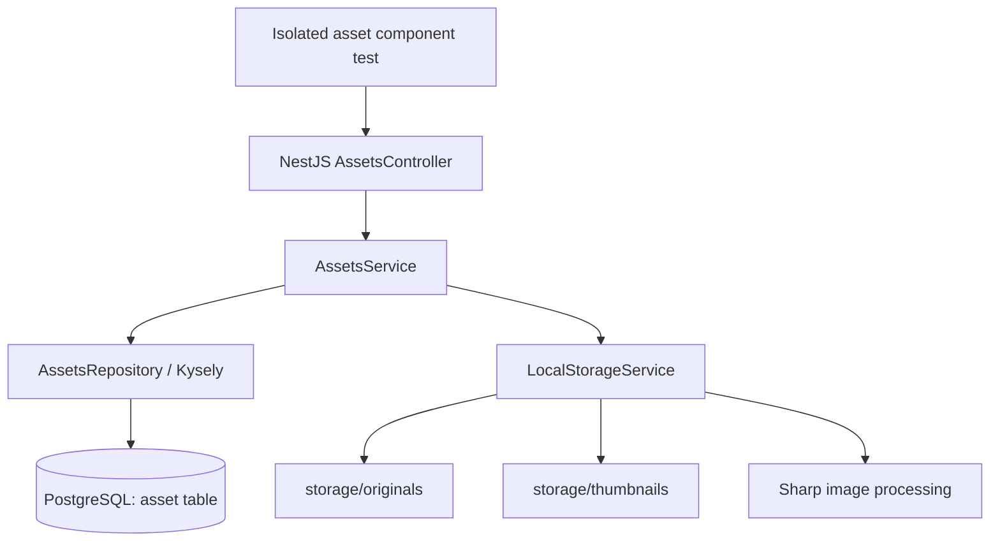

# Saefr Photos — Backend Architecture (as implemented)

**Verified reference:** M9 foundation through `3679682`; M10 merged through [PR #2](https://github.com/saefr-app/saefr-photos/pull/2) into `integration` as `acf6ed44bb870fdae56e68c523ba660af6536897` on 2026-10-22. Phase 11B ownership schema is implemented on an uncommitted feature branch and awaiting review. No production deployment or development-database migration has occurred. **Implemented** and **planned** are deliberately separated.

## M10 authentication foundation and current privacy boundary

The production `AppModule` no longer imports `AssetsModule`. Before listening, Fastify registers an `onRequest` asset-namespace boundary, so multipart parsing and asset storage code are never reached through the production API. Anonymous asset requests return 401; a valid browser session, including an administrator, receives a fixed 503. A failed session lookup also returns a sanitized 503. Existing asset code remains exercised through an isolated test module only. No legacy ownerless asset is assigned to a user.

The backend now requires an exact `APP_ORIGIN`. Production requires HTTPS; development/test HTTP is limited to loopback. Browser login at `/api/v1/auth/login` issues a random opaque session credential in an HttpOnly, SameSite=Lax cookie (`__Host-saefr_session` with Secure/Path=/ in production). PostgreSQL stores only its SHA-256 hash. Session resolution checks current account status and expiry on every protected request. Login, `/api/v1/me`, password change, logout, logout-all and own-session list/revocation are implemented. Phase 10B.5 adds administrator-only ordinary-user creation, account listing and account disable. Creation and disable reverify the administrator password under a user-row lock; disable serializes concurrent administrator operations before revoking target sessions. Unsafe authenticated requests require exact Origin and a separate session CSRF token. A default-deny Nest guard protects non-public routes. The single-process login and password-work limits are bounded, with restart and multi-node limits documented in the phase reports.

Startup checks the strict managed M10 schema and fails before listening if it is missing or incompatible. It never runs migrations. Swagger is disabled in the production composition by default. M10 authentication is integrated and post-merge verified but is **not** a self-hostable multi-user photo release: the approved [M11 ownership design](decisions/0005-asset-ownership.md) requires owner-scoped authorization before media routes reopen; existing ownerless records remain quarantined pending a separately approved mapping. Phase 10B.6 expanded Origin, CSRF, restricted-session and asset-lockdown regressions; its actual results are in the [Phase 10B.6 report](development/milestone-10b6-report.md).

## Current system

- **HTTP/API:** `server-nest/` — NestJS 12 on Fastify, Node.js 24, TypeScript ESM/NodeNext. The server binds to `127.0.0.1:3000` by default while M10/M11 remain incomplete.
- **Runtime configuration:** Nest ConfigModule loads the existing environment files and validates database, listen, environment, storage and exact `APP_ORIGIN` settings before application initialization. Database name, user, password and application origin are required; host, ports, environment and storage path have explicit defaults. Startup errors do not print configuration values. The migration CLI retains its separate `MIGRATION_POSTGRES_*` configuration and never runs during API startup.
- **Database:** PostgreSQL 18 with a Kysely query builder and `pg` connection pool; root `compose.yml` starts the **database only**. NestJS currently runs on the host, not in Docker.
- **Files:** local root `storage/originals/` contains original image bytes; `storage/thumbnails/` contains JPEG previews.
- **Processing:** Sharp/libvips validates JPEG, PNG, WebP and generates 300px bounding-box JPEG thumbnails (quality 85). Multipart parsing and storage independently enforce a 20 MiB file limit; Sharp rejects images over 40 million pixels and multi-page images.
- **Documentation:** Swagger is disabled by default in the M10 production composition. Legacy asset OpenAPI behavior remains covered in an isolated test composition.
- **Errors and logs:** Nest's app-wide exception filter returns stable, sanitized HTTP error bodies. An early media-stream failure clears stale media headers before the JSON error is sent; a failure after headers are sent closes the connection. Unexpected request failures log a known route pattern and allowlisted error category, never raw exception objects. Readiness, storage cleanup, PostgreSQL idle-client and startup failures likewise avoid raw driver messages and filesystem paths.
- **Legacy code:** `server/` contains the previous FastAPI + SQLModel implementation. The existing PostgreSQL `asset` schema originated there; existing image files remain in `storage/`.

## Request flow



### Retained asset implementation (isolated component tests only)

The flow below is retained for M11 and test coverage; the production application blocks it before parsing.

#### Upload: `POST /api/v1/assets/upload`

1. The controller accepts one multipart `file` part, starts its stream immediately, and enforces part and file-size limits.
2. Controller forwards filename, claimed MIME type and stream to `AssetsService.upload()`; it also verifies the multipart parser reached the request's end before storage publishes files.
3. Service validates/sanitizes filename, creates a UUID and calls `LocalStorageService.saveImage()`.
4. Storage streams to a private temporary original with a second 20 MiB limit. Sharp checks actual file format/dimensions and generates a temporary thumbnail.
5. After full multipart validation, storage hard-links the temporary files to UUID-derived final names. Existing final files cannot be overwritten; the service then inserts metadata through Kysely.
6. Normal stream, parsing, image, and filesystem failures remove temporary and newly published files where the filesystem permits. If DB insertion fails, the service **attempts** to remove its new files. Cross-filesystem/DB atomicity is **not guaranteed**; crash recovery and reconciliation remain planned.
7. Returns `201 Created` with public asset metadata (`storage_path` is never in the public response).

#### Retrieval

- `GET /api/v1/assets/` (and without trailing slash): returns unpaginated metadata newest first.
- `GET /api/v1/assets/:assetId`: validates UUID, returns metadata or 404.
- `GET /api/v1/assets/:assetId/original`: looks up internal metadata, safely opens the UUID-derived local file, returns a `StreamableFile` in the original MIME type.
- `GET /api/v1/assets/:assetId/thumbnail`: returns the JPEG thumbnail as a stream.
- `GET /health`: process liveness response; `GET /health/ready`: performs database `SELECT 1` and returns 503 if unavailable.

## Current backend layout

```text
server-nest/
  src/
    main.ts              # app bootstrap, asset boundary, schema readiness
    app.module.ts        # Config, Health, Auth, Users; no production AssetsModule
    runtime-config.ts    # validated API runtime settings and defaults
    errors/              # safe HTTP exception responses and log categories
    assets/              # HTTP controller, orchestration, Kysely repository, DTO
    auth/                # browser sessions, guard, origin/CSRF, asset boundary
    users/               # administrator account API and local operator tools
    database/            # connection pool, Kysely types, DB ping
      migrations/        # standalone CLI, schema checks, immutable versions
    health/              # health and readiness checks
    storage/             # original/thumbnail reading, upload staging, Sharp
    openapi/             # Swagger setup
  test/                  # mocked HTTP tests and isolated PostgreSQL integration tests
  package.json           # npm scripts and dependencies
server/                  # legacy Python backend (do not delete yet)
compose.yml              # only PostgreSQL currently
storage/originals/       # ignored original files (preserve)
storage/thumbnails/      # ignored generated files (preserve)
```

## Verified database schema and migrations

The maintainer's `psql \d+ public.asset` inspection confirmed UUID `id`, unbounded VARCHAR `filename`/`mime_type`/`storage_path`, INTEGER `size`, and TIMESTAMP WITH TIME ZONE `created_at`. All columns are NOT NULL with no database defaults; `asset_pkey` is the primary key/index on `id`. This matches the SQLModel-generated schema tested in M7. M8 did not independently query the development database.

The standalone migration CLI uses Kysely `Migrator`, version files and `public.kysely_migration`/`public.kysely_migration_lock`. Fresh installs create the verified schema. Explicitly opted-in legacy baselines validate and lock the existing table, then record the initial version without changing the table or rows. Incompatible schemas/history fail without automatic repair. A runner advisory lock serializes preflight/bootstrap; Kysely applies pending versions and ledger entries transactionally. Metadata bootstrap itself precedes that transaction and may remain after failure.

The Phase 11B version adds nullable `owner_id` to `asset`, an owner FK, ordering index and an enforced but unvalidated non-NULL check. Migration history selects the frozen M8 inspector for pre-M11 assets or an exact M11 inspector after that version. Existing asset rows and paths remain unchanged, with NULL ownership. This schema is only in the feature branch and disposable test databases; the development database was not upgraded. The API still requires M10 readiness and keeps every production asset route locked.

Migration commands require dedicated `MIGRATION_POSTGRES_*` settings and database confirmation, and never run during API startup. See [database-migrations.md](development/database-migrations.md). The application still exposes `created_at` as UTC ISO text and keeps storage paths internal.

## Known limitations / not yet implemented

- Phase 11B adds an owner column and database constraints, but per-user media authorization is not implemented. Existing ownerless rows remain quarantined. **Do not publicly expose or re-enable** media endpoints before the later reviewed M11 route boundary.
- No asset deletion/trash or cursor pagination.
- HTTP tests mostly mock repository/storage; Phase 9B also runs upload HTTP cases against real storage in isolated temporary directories. The separate PostgreSQL 18 suite verifies the migrated schema, repository behavior, legacy baselining, repeat runs, concurrency and failure cases using a disposable database. Real development migrations and restoration from a real backup were not exercised.
- `size` remains a signed 32-bit INTEGER. No large-file or timestamp conversion was introduced. Historical development records were not inspected or changed by M8.
- Cross-system upload durability and startup recovery are not complete. A process/host crash can strand temporary files, one published file, or files without metadata. A database error with an uncertain commit outcome can cause compensation to remove files for a committed row. Cleanup can fail if the filesystem is unavailable or permissions change. No broad automatic deletion is implemented.
- Focused failure-injection tests for filesystem write and cleanup failures remain to be added; existing tests cover stream interruptions, invalid images, collisions and simulated database failures.
- Local filesystem safety assumes the configured storage root and its parent are controlled by the operator; it does not defend against a privileged process replacing directories concurrently. Isolated filesystem/NAS support and a full upload resource threat model remain future work.
- No fully Dockerized backend or Redis/BullMQ worker yet; no mobile application or ML service integrated.
- Swagger/OpenAPI remains in source for isolated tests but is disabled in the production composition during M10.
- Explicit `HOST` values can bind the API beyond localhost; TLS/proxy and deployment controls are still required before public exposure. Startup validates configuration and the exact managed M10 schema, but does not create storage directories.
- The app handles SIGTERM through Nest shutdown hooks and closes its HTTP listener and Kysely pool. The standalone runtime smoke checks safe configuration and database-startup failures; a real localhost listener and SIGTERM are checked against disposable PostgreSQL in the authentication integration suite. Neither proves behavior during a host crash, blocked I/O or a real production deployment. An error after streaming response headers have been sent cannot be turned into a fresh JSON error response.
- Logs retain safe route/category diagnostics but do not yet have request correlation, durable collection or alerting. Framework errors outside Nest's request exception pipeline may use Fastify's own response handling; deployment-facing error behavior needs review with a secured production stack.

## Documentation rule

Source code and actual test observations supersede stale diagrams. Update this file when architecture changes, and mark new capabilities as **planned** until implemented and verified.
