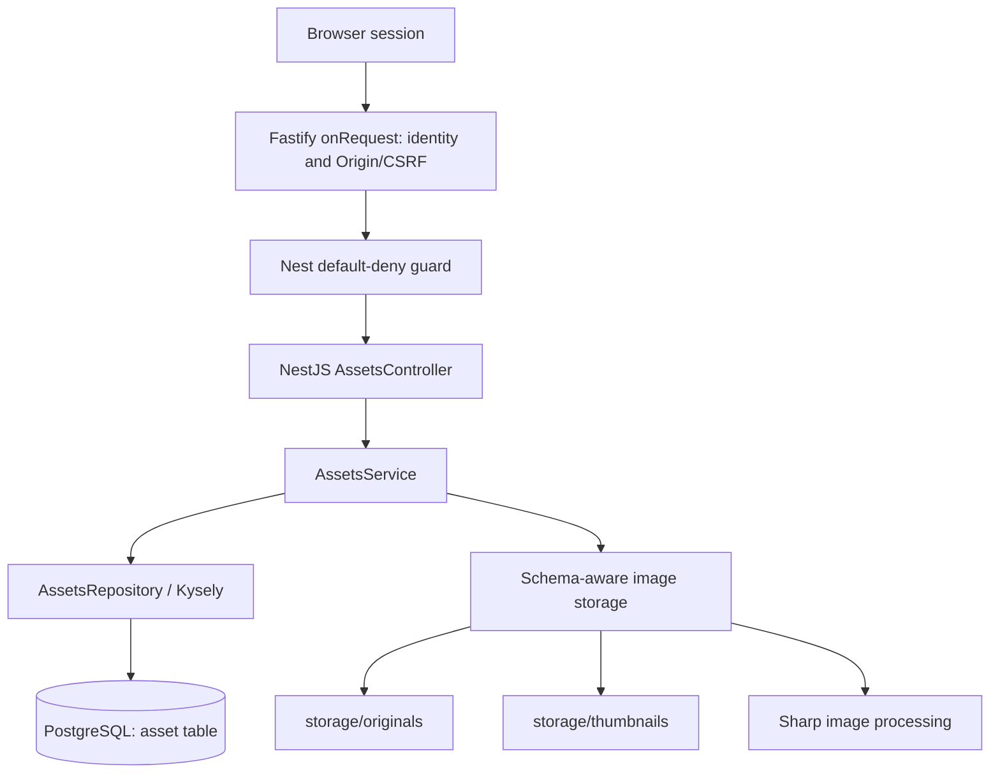

# Saefr Photos — Backend Architecture (as implemented)

**Verified reference:** M9 foundation through `3679682`; M10 merged through [PR #2](https://github.com/saefr-app/saefr-photos/pull/2) into `integration` as `acf6ed44bb870fdae56e68c523ba660af6536897` on 2026-10-22. M11B ownership schema, M11C owner-scoped core and M11D secure HTTP exposure were independently reviewed and committed as `e0b2585`, `a355b138` and `4aa46ed`. M11F passed independent GPT-6 Astra Extra High security review and was committed as `04674f0`; see the [11F report](development/milestone-11f-report.md). [PR #4](https://github.com/saefr-app/saefr-photos/pull/4) merged M11 into `integration` as `2141bb955b251ca44132d13af7ebfe3b18c7dfc2` on 2026-10-23, followed by [local post-merge verification](development/milestone-11-postmerge-report.md). No production deployment or development-database migration has been approved or performed. **Implemented** and **planned** are deliberately separated.

## Authentication and current asset privacy boundary

The production `AppModule` mounts the reviewed owner-scoped `AssetsModule`. Bootstrap installs `registerAssetAccess()` at Fastify's `onRequest` stage before listening: cookie-only authentication, unrestricted-account checks and exact Origin/session CSRF for unsafe asset-namespace methods run before content parsing. Invalid or absent credentials receive sanitized 401, restricted accounts 403, and authentication lookup failures 503. The default-deny Nest guard independently enforces route policy and attaches the typed actor; controllers still require it. A private request-keyed WeakMap reuses successful session resolution within that request, while credential parsing, unsupported-header rejection and guard policy still run. Future requests resolve current session state; upload commit retains 11C's final locked revalidation. Administrators have no media bypass. Legacy NULL-owned rows remain invisible and unassigned.

Namespace detection uses the matched router pattern for actual handlers plus decoded static-path checks for unmatched namespace requests. The shared `createHttpAdapter()` sanitizes malformed-URL errors that happen before hooks. All recognized asset responses use `Cache-Control: no-store` and `X-Content-Type-Options: nosniff`. Real-socket tests cover matched percent-encoded segments, trailing slashes, unknown unsafe paths, HEAD fallback and full-200 Range responses. Unsupported encoded separators/double encoding remain unavailable; no aliases were added. `/api/v1/me` reports `assetsAvailable:true` only for unrestricted authenticated users/admins, indicating route capability rather than ownership or deployment readiness.

The backend now requires an exact `APP_ORIGIN`. Production requires HTTPS; development/test HTTP is limited to loopback. Browser login at `/api/v1/auth/login` issues a random opaque session credential in an HttpOnly, SameSite=Lax cookie (`__Host-saefr_session` with Secure/Path=/ in production). PostgreSQL stores only its SHA-256 hash. Session resolution checks current account status and expiry on every protected request. Login, `/api/v1/me`, password change, logout, logout-all and own-session list/revocation are implemented. Phase 10B.5 adds administrator-only ordinary-user creation, account listing and account disable. Creation and disable reverify the administrator password under a user-row lock; disable serializes concurrent administrator operations before revoking target sessions. Unsafe authenticated requests require exact Origin and a separate session CSRF token. A default-deny Nest guard protects non-public routes. The single-process login and password-work limits are bounded, with restart and multi-node limits documented in the phase reports.

Startup validates the exact applied migration history and catalog. The M12 feature branch accepts exact M11 history within its historical compatibility boundary or exact M12 history; earlier, partial or tampered states fail before listening. It never runs migrations. An M12 schema with unavailable or unadopted storage permits authenticated metadata only; media and new deletion acceptance require fresh binding checks. Swagger remains disabled by default. M10 and [M11 ownership](decisions/0005-asset-ownership.md) are merged into `integration`; M12 remains on its draft feature branch. Legacy ownerless records remain quarantined, and deployment controls remain unverified.

## Current system

- **HTTP/API:** `server/` — the sole maintained backend, using NestJS 12 on Fastify, Node.js 24 and TypeScript ESM/NodeNext. The server binds to `127.0.0.1:3000` by default while deployment controls remain unverified.
- **Runtime configuration:** Nest ConfigModule loads the existing environment files and validates database, listen, environment, storage and exact `APP_ORIGIN` settings before application initialization. Database name, user, password and application origin are required; host, ports, environment and storage path have explicit defaults. Startup errors do not print configuration values. The migration CLI retains its separate `MIGRATION_POSTGRES_*` configuration and never runs during API startup.
- **Database:** PostgreSQL 18 with a Kysely query builder and `pg` connection pool; root `compose.yml` starts the **database only**. NestJS currently runs on the host, not in Docker.
- **Files:** local root `storage/originals/` contains original image bytes; `storage/thumbnails/` contains JPEG previews.
- **Processing:** Sharp/libvips validates JPEG, PNG, WebP and generates 300px bounding-box JPEG thumbnails (quality 85). Multipart parsing and storage independently enforce a 20 MiB file limit; Sharp rejects images over 40 million pixels and multi-page images.
- **Documentation:** Swagger is disabled by default in the M10 production composition. Legacy asset OpenAPI behavior remains covered in an isolated test composition.
- **Errors and logs:** Nest's app-wide exception filter returns stable, sanitized HTTP error bodies. An early media-stream failure clears stale media headers before the JSON error is sent; a failure after headers are sent closes the connection. Unexpected request failures log a known route pattern and allowlisted error category, never raw exception objects. Readiness, storage cleanup, PostgreSQL idle-client and startup failures likewise avoid raw driver messages and filesystem paths.
- **Legacy code:** The previous FastAPI + SQLModel source is retired and recoverable from Git history. The existing PostgreSQL `asset` schema originated there; existing image files remain in `storage/`.

## Request flow



### Owner-scoped asset implementation

The base owner-scoped flow is mounted in the merged `integration` application behind the early gate; the draft M12 branch extends it with lifecycle and bound storage. Isolated component/storage tests are also retained. Post-merge verification used disposable PostgreSQL and temporary media, not the development database or stored photographs.

#### Upload: `POST /api/v1/assets/upload`

1. After early authentication/Origin/CSRF and the guard, the controller accepts one multipart `file` part, starts its stream immediately, and enforces part and file-size limits.
2. Controller forwards filename, claimed MIME type and stream to `AssetsService.upload()`; it also verifies the multipart parser reached the request's end before storage publishes files.
3. Service validates/sanitizes filename, creates a UUID and calls the schema-selected image storage adapter. Exact M11 history retains `LocalStorageService`; exact M12 history selects the bound provider only after storage verification.
4. Storage streams to private staging with a second 20 MiB limit. Sharp checks actual file format/dimensions and generates a temporary thumbnail.
5. After full multipart validation, storage publishes to UUID-derived final names without replacement. The M12 provider also persists publication and verifies both role bindings. The repository then locks the actor's user and session rows in a short transaction, rechecks active/unrestricted status and database wall-clock expiry, and inserts metadata with the actor's owner UUID. M12 finalization also coordinates on the asset-ID lock and rejects retired IDs.
6. Normal stream, parsing, image, and filesystem failures remove temporary and newly published files where the filesystem permits. The 11C core attempts to remove only this upload's files after failure before transaction callback entry or an acknowledged callback rollback; it retains files if COMMIT outcome is uncertain or acknowledged. Cross-filesystem/DB atomicity is **not guaranteed**; crash recovery and reconciliation remain planned.
7. Returns `201 Created` with public asset metadata (`storage_path` is never in the public response).

#### Retrieval

- `GET /api/v1/assets/` (and without trailing slash) returns a bounded owner-only active-asset page with `items` and `next_cursor`, newest first by `created_at, id`. The feature branch also has owner-only Trash and pending-deletion pages.
- `GET /api/v1/assets/:assetId` uses an owner predicate and returns metadata or the same 404 for foreign, ownerless and missing rows.
- `GET /api/v1/assets/:assetId/original` and `/thumbnail` require scoped metadata before any storage open. Foreign, NULL-owned and absent valid IDs have the same sanitized 404 before storage is opened. HEAD uses the same scope checks with no body; Range is ignored, preserving full 200 responses.
- `GET /health`: process liveness response; `GET /health/ready`: performs database `SELECT 1` and returns 503 if unavailable.

## Current backend layout

```text
server/
  src/
    main.ts              # app bootstrap, asset boundary, schema readiness
    app.module.ts        # Config, Health, Auth, Users, scoped AssetsModule
    http-adapter.ts      # shared Fastify options and safe pre-hook URL errors
    runtime-config.ts    # validated API runtime settings and defaults
    errors/              # safe HTTP exception responses and log categories
    assets/              # HTTP controller, orchestration, Kysely repository, DTO
    auth/                # browser sessions, guard, origin/CSRF, asset boundary
    users/               # administrator account API and local operator tools
    database/            # connection pool, Kysely types, DB ping
      migrations/        # standalone CLI, schema checks, immutable versions
    health/              # health and readiness checks
    storage/             # original/thumbnail reading, upload staging, Sharp
    openapi/             # Swagger setup
  test/                  # mocked HTTP tests and isolated PostgreSQL integration tests
  package.json           # npm scripts and dependencies
web/                     # reserved for a future frontend; not scaffolded
compose.yml              # only PostgreSQL currently
storage/originals/       # ignored original files (preserve)
storage/thumbnails/      # ignored generated files (preserve)
```

## Verified database schema and migrations

The maintainer's `psql \d+ public.asset` inspection confirmed UUID `id`, unbounded VARCHAR `filename`/`mime_type`/`storage_path`, INTEGER `size`, and TIMESTAMP WITH TIME ZONE `created_at`. All columns are NOT NULL with no database defaults; `asset_pkey` is the primary key/index on `id`. This matches the SQLModel-generated schema tested in M7. M8 did not independently query the development database.

The standalone migration CLI uses Kysely `Migrator`, version files and `public.kysely_migration`/`public.kysely_migration_lock`. Fresh installs create the verified schema. Explicitly opted-in legacy baselines validate and lock the existing table, then record the initial version without changing the table or rows. Incompatible schemas/history fail without automatic repair. A runner advisory lock serializes preflight/bootstrap; Kysely applies pending versions and ledger entries transactionally. Metadata bootstrap itself precedes that transaction and may remain after failure.

The Phase 11B version adds nullable `owner_id` to `asset`, an owner FK, ordering index and an enforced but unvalidated non-NULL check. Migration history selects the frozen M8 inspector for pre-M11 assets or an exact M11 inspector after that version. Existing asset rows and paths remain unchanged, with NULL ownership. The schema source is merged into `integration`, but it has been applied only to disposable test databases; the development database was not upgraded. The 11D API requires M11 readiness before listening and enforces owner-scoped asset authorization.

The merged M12B migration adds asset lifecycle columns, a separate permanent-deletion journal and an initially empty `storage_binding` singleton table. Its exact validator preserves historical M8/M10/M11 schema contracts. The M12C feature branch adds marker-v2 parsing, binding verification, a provider-backed image adapter selected only for exact M12 schema history, explicit synthetic-tested provisioning/adoption/recovery primitives, upload asset-ID coordination and a descriptor-only Linux observer. The feature-branch production bootstrap accepts exact M11 history unchanged and exact M12 history for authenticated metadata-only access when storage is unadopted or unavailable. M12 media operations require both verified role identities at operation time and never fall back to M11 storage. Invalid history refuses startup before listening. Focused native ext4 and process-kill tests passed on a disposable hosted VM; broader crash and deployment certification remains open. No M12 storage behavior is deployed or approved for real-data use.

M12D on the same feature branch replaces the active-gallery array with bounded keyset pages (`items`, `next_cursor`) and adds owner-scoped Trash and pending-deletion pages. Cursors retain PostgreSQL microseconds and are validated for owner, collection and exact encoding; they are positions, never credentials. Trash/Restore require a current strong lifecycle ETag and use short transactions with user, session, asset-ID and owned-row locks in that order. Trashed rows are excluded in owner-scoped SQL from ordinary metadata and media reads. Only the owner can stream a Trash thumbnail through the binding-aware provider; no Trash original route exists. These transitions do not remove files. The deletion-journal list is read-only: permanent deletion acceptance, execution, retry and expiry are not activated by M12D. The [M12D report](development/milestone-12d-report.md) records verification and remaining gates; feature-branch behavior is not a real-data upgrade or deployment approval.

M12E.1 added an internal, bounded permanent-deletion executor for positively committed owner-scoped journal receipts. It validates the immutable target tuple against the adopted database anchor and both physical role bindings, acquires a short PostgreSQL token claim, removes only the layout-1 UUID original and thumbnail through the verified provider, confirms directory persistence, and records token-guarded completion. It holds no database transaction across filesystem I/O. Partial or uncertain outcomes remain pending for later explicit retry; an expired claim can overlap an already issued syscall, so removal is repeat-safe rather than exactly once. The [M12E.1 report](development/milestone-12e1-report.md) records its independent review and limits.

M12E.2 on the feature branch adds owner-authorized permanent deletion from Trash, owner-only receipt status and explicit retry. Acceptance is a short transaction that locks the current account, session, asset ID, owned asset and database storage anchor; it inserts an immutable journal and removes the asset row atomically before invoking the existing executor. A lost COMMIT acknowledgement needs a matching independent journal read before filesystem work. Repeated DELETE only reads the existing receipt; pending work has no automatic retry in M12. Initial storage support remains limited to the verified Linux/ext4 profile. See the [M12E.2 report](development/milestone-12e2-report.md). This feature-branch implementation is not a real-data migration or deployment approval.

The [M12F report](development/milestone-12f-report.md) records the milestone-wide local regression run and its focused session-revocation race test. The sole maintained NestJS backend moved to `server/` in committed restructuring `8571bad`; the former FastAPI source was retired. Independent restructuring review passed, and [hosted ext4 run 40649284746](https://github.com/saefr-app/saefr-photos/actions/runs/40649284746) passed at implementation SHA `8571badf700849c8120ac6be51552c5b0fbe1ccb`. The final integrated M12 security review passed with two LOW findings; focused local corrections now await independent re-review and maintainer sign-off. M12 remains on the draft feature branch, unmerged into `integration`. Real-data migration, storage adoption and deployment remain unapproved.

Migration commands require dedicated `MIGRATION_POSTGRES_*` settings and database confirmation, and never run during API startup. See [database-migrations.md](development/database-migrations.md). The application still exposes `created_at` as UTC ISO text and keeps storage paths internal.

## Known limitations / not yet implemented

- Phases 11B, 11C and 11D are independently reviewed checkpoints. Phase 11F completed fresh regression verification, passed independent GPT-6 Astra Extra High review with a PASS verdict, and was committed as `04674f0`. M11 merged into `integration` through [PR #4](https://github.com/saefr-app/saefr-photos/pull/4) at `2141bb9` and passed [local post-merge checks](development/milestone-11-postmerge-report.md). Legacy NULL-owned rows remain quarantined, and optional M11E mapping is deferred. Public exposure, deployment and real-data migration remain unapproved. See the [11F report](development/milestone-11f-report.md) for its historical pre-merge evidence.
- M12 lifecycle routes remain on the draft feature branch. Trash and Restore are reversible metadata transitions; permanent deletion requires a committed journal, explicit request execution and verified storage. No automatic Trash expiry, retry scheduler or general orphan cleanup exists; those are M13 work.
- Component HTTP tests mock repository/storage; the 11D production-composition matrix uses real localhost sockets, real sessions/PostgreSQL and temporary media. Only failure-injection cases replace storage reads or session lookup. Phase 9B also runs upload HTTP cases against real storage in isolated temporary directories. The separate PostgreSQL 18 suite verifies the migrated schema, repository behavior, legacy baselining, repeat runs, concurrency and failure cases using a disposable database. Real development migrations and restoration from a real backup were not exercised.
- `size` remains a signed 32-bit INTEGER. No large-file or timestamp conversion was introduced. Historical development records were not inspected or changed by M8.
- Cross-system upload durability and startup recovery are not complete. A process/host crash can strand temporary files, one published file, or files without metadata. The reviewed 11C core retains files when COMMIT outcome is uncertain, avoiding deliberate deletion of possibly committed media. Cleanup after an acknowledged rollback can fail if the filesystem is unavailable or permissions change. No broad automatic deletion is implemented.
- M12 adds focused synthetic storage failure and partial-deletion tests, plus guarded native ext4 process-kill checks. These do not prove power-loss durability, certify other filesystem profiles or reconcile unknown upload orphans.
- The initial verified Linux/ext4 profile assumes operator-controlled storage ancestors, mounts and managed media. It does not defend against a privileged process replacing them concurrently. Windows, macOS, other local filesystems and NAS require separate profile verification.
- No fully Dockerized backend or Redis/BullMQ worker yet; no mobile application or ML service integrated.
- Swagger/OpenAPI remains in source for isolated tests but is disabled in the production composition during M10.
- Explicit `HOST` values can bind the API beyond localhost; TLS/proxy and deployment controls are still required before public exposure. Startup validates configuration and exact supported M11/M12 history without creating storage directories or markers.
- The app handles SIGTERM through Nest shutdown hooks and closes its HTTP listener and Kysely pool. The standalone runtime smoke checks safe configuration and database-startup failures; a real localhost listener and SIGTERM are checked against disposable PostgreSQL in the authentication integration suite. Neither proves behavior during a host crash, blocked I/O or a real production deployment. An error after streaming response headers have been sent cannot be turned into a fresh JSON error response.
- Logs retain safe route/category diagnostics but do not yet have request correlation, durable collection or alerting. Malformed URL errors before Nest hooks have fixed JSON responses. Deployment-facing proxy/TLS and other transport error behavior still need review with a secured production stack.

## Documentation rule

Source code and actual test observations supersede stale diagrams. Update this file when architecture changes, and mark new capabilities as **planned** until implemented and verified.
