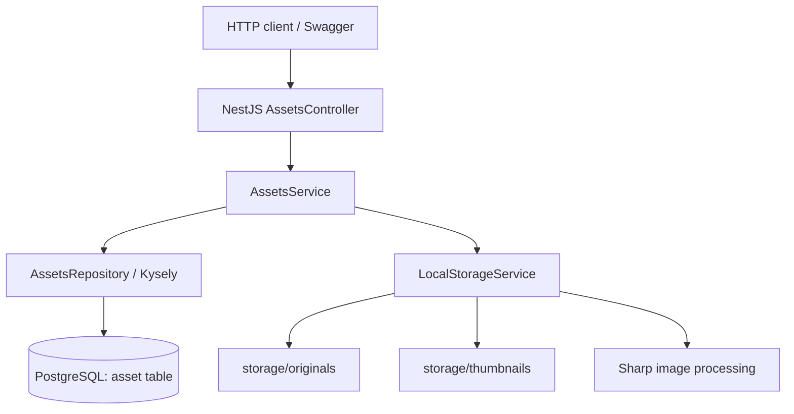

# Saefr Photos — Backend Architecture (as implemented)

**Verified reference:** Local `refactor/nestjs-migration` working tree at committed Phase 9A (`f8930be`), with uncommitted Phase 9B upload and filesystem changes on 2026-10-17 IST. Update this document after substantive architecture changes. **Implemented** and **planned** are deliberately separated.

## Current system
- **HTTP/API:** `server-nest/` — NestJS 12 on Fastify, Node.js 24, TypeScript ESM/NodeNext. The server binds to `127.0.0.1:3000` by default; this is appropriate for unauthenticated local development only.
- **Runtime configuration:** Nest ConfigModule loads the existing environment files and validates database, listen, environment and storage settings before application initialization. Database name, user and password are required; host, ports, environment and storage path have explicit defaults. Startup errors do not print configuration values. The migration CLI retains its separate `MIGRATION_POSTGRES_*` configuration and never runs during API startup.
- **Database:** PostgreSQL 18 with a Kysely query builder and `pg` connection pool; root `compose.yml` starts the **database only**. NestJS currently runs on the host, not in Docker.
- **Files:** local root `storage/originals/` contains original image bytes; `storage/thumbnails/` contains JPEG previews.
- **Processing:** Sharp/libvips validates JPEG, PNG, WebP and generates 300px bounding-box JPEG thumbnails (quality 85). Multipart parsing and storage independently enforce a 20 MiB file limit; Sharp rejects images over 40 million pixels and multi-page images.
- **Documentation:** Swagger UI at `/docs` and OpenAPI JSON at `/docs-json` when `NODE_ENV` is not `production`.
- **Legacy code:** `server/` contains the previous FastAPI + SQLModel implementation. The existing PostgreSQL `asset` schema originated there; existing image files remain in `storage/`.

## Request flow


### Upload: `POST /api/v1/assets/upload`
1. The controller accepts one multipart `file` part, starts its stream immediately, and enforces part and file-size limits.
2. Controller forwards filename, claimed MIME type and stream to `AssetsService.upload()`; it also verifies the multipart parser reached the request's end before storage publishes files.
3. Service validates/sanitizes filename, creates a UUID and calls `LocalStorageService.saveImage()`.
4. Storage streams to a private temporary original with a second 20 MiB limit. Sharp checks actual file format/dimensions and generates a temporary thumbnail.
5. After full multipart validation, storage hard-links the temporary files to UUID-derived final names. Existing final files cannot be overwritten; the service then inserts metadata through Kysely.
6. Normal stream, parsing, image, and filesystem failures remove temporary and newly published files where the filesystem permits. If DB insertion fails, the service **attempts** to remove its new files. Cross-filesystem/DB atomicity is **not guaranteed**; crash recovery and reconciliation remain planned.
7. Returns `201 Created` with public asset metadata (`storage_path` is never in the public response).

### Retrieval
- `GET /api/v1/assets/` (and without trailing slash): returns unpaginated metadata newest first.
- `GET /api/v1/assets/:assetId`: validates UUID, returns metadata or 404.
- `GET /api/v1/assets/:assetId/original`: looks up internal metadata, safely opens the UUID-derived local file, returns a `StreamableFile` in the original MIME type.
- `GET /api/v1/assets/:assetId/thumbnail`: returns the JPEG thumbnail as a stream.
- `GET /health`: process liveness response; `GET /health/ready`: performs database `SELECT 1` and returns 503 if unavailable.

## Current backend layout
```text
server-nest/
  src/
    main.ts              # app bootstrap, Fastify, Swagger setup
    app.module.ts        # Config, Health, Assets
    runtime-config.ts    # validated API runtime settings and defaults
    assets/              # HTTP controller, orchestration, Kysely repository, DTO
    database/            # connection pool, Kysely types, DB ping
      migrations/        # standalone CLI, schema checks, immutable versions
    health/              # health and readiness checks
    storage/             # original/thumbnail reading, upload staging, Sharp
    openapi/             # Swagger setup
  test/                  # mocked HTTP tests and isolated PostgreSQL integration tests
  package.json           # npm scripts and dependencies
server/                  # legacy Python backend (do not delete yet)
compose.yml              # only PostgreSQL currently
storage/originals/       # ignored original files (preserve)
storage/thumbnails/      # ignored generated files (preserve)
```

## Verified database schema and migrations
The maintainer's `psql \d+ public.asset` inspection confirmed UUID `id`, unbounded VARCHAR `filename`/`mime_type`/`storage_path`, INTEGER `size`, and TIMESTAMP WITH TIME ZONE `created_at`. All columns are NOT NULL with no database defaults; `asset_pkey` is the primary key/index on `id`. This matches the SQLModel-generated schema tested in M7. M8 did not independently query the development database.

The standalone migration CLI uses Kysely `Migrator`, version files and `public.kysely_migration`/`public.kysely_migration_lock`. Fresh installs create the verified schema. Explicitly opted-in legacy baselines validate and lock the existing table, then record the initial version without changing the table or rows. Incompatible schemas/history fail without automatic repair. A runner advisory lock serializes preflight/bootstrap; Kysely applies pending versions and ledger entries transactionally. Metadata bootstrap itself precedes that transaction and may remain after failure.

Migration commands require dedicated `MIGRATION_POSTGRES_*` settings and database confirmation, and never run during API startup. See [database-migrations.md](development/database-migrations.md). The application still exposes `created_at` as UTC ISO text and keeps storage paths internal.

## Known limitations / not yet implemented
- No accounts, sessions, per-user asset ownership or authorization. **Do not publicly expose** this API.
- No asset deletion/trash or cursor pagination.
- HTTP tests mostly mock repository/storage; Phase 9B also runs upload HTTP cases against real storage in isolated temporary directories. The separate PostgreSQL 18 suite verifies the migrated schema, repository behavior, legacy baselining, repeat runs, concurrency and failure cases using a disposable database. Real development migrations and restoration from a real backup were not exercised.
- `size` remains a signed 32-bit INTEGER. No large-file or timestamp conversion was introduced. Historical development records were not inspected or changed by M8.
- Cross-system upload durability and startup recovery are not complete. A process/host crash can strand temporary files, one published file, or files without metadata. A database error with an uncertain commit outcome can cause compensation to remove files for a committed row. Cleanup can fail if the filesystem is unavailable or permissions change. No broad automatic deletion is implemented.
- Local filesystem safety assumes the configured storage root and its parent are controlled by the operator; it does not defend against a privileged process replacing directories concurrently. Isolated filesystem/NAS support and a full upload resource threat model remain future work.
- No fully Dockerized backend or Redis/BullMQ worker yet; no mobile application or ML service integrated.
- Swagger/OpenAPI is development-only by environment convention, not an authentication mechanism.
- Explicit `HOST` values can bind the API beyond localhost; authentication and deployment controls are still required before public exposure. Startup validates configuration but does not test database connectivity or create storage directories; readiness and first media access report those failures.

## Documentation rule
Source code and actual test observations supersede stale diagrams. Update this file when architecture changes, and mark new capabilities as **planned** until implemented and verified.
