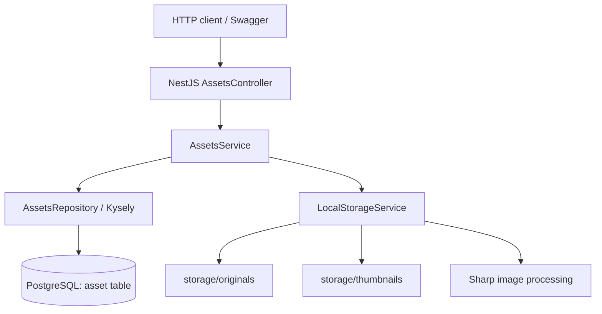

# Saefr Photos — Backend Architecture (as implemented)

**Verified reference:** GitHub `refactor/nestjs-migration` at commit `19b14677555d7b1a5decc0732b0d468cf9f54940` (2026-10-16 IST). Update this document after substantive architecture changes. **Implemented** and **planned** are deliberately separated.

## Current system
- **HTTP/API:** `server-nest/` — NestJS 12 on Fastify, Node.js 24, TypeScript ESM/NodeNext. The server binds to `127.0.0.1:3000` by default; this is appropriate for unauthenticated local development only.
- **Database:** PostgreSQL 18 with a Kysely query builder and `pg` connection pool; root `compose.yml` starts the **database only**. NestJS currently runs on the host, not in Docker.
- **Files:** local root `storage/originals/` contains original image bytes; `storage/thumbnails/` contains JPEG previews.
- **Processing:** Sharp/libvips validates JPEG, PNG, WebP and generates 300px bounding-box JPEG thumbnails (quality 85). The upload endpoint currently enforces a 20 MiB multipart file limit and the storage service limits decoded images to 40 million pixels.
- **Documentation:** Swagger UI at `/docs` and OpenAPI JSON at `/docs-json` when `NODE_ENV` is not `production`.
- **Legacy code:** `server/` contains the previous FastAPI + SQLModel implementation. The existing PostgreSQL `asset` schema originated there; existing image files remain in `storage/`.

## Request flow


### Upload: `POST /api/v1/assets/upload`
1. `FileStreamInterceptor` processes a multipart `file` stream with upload limits.
2. Controller forwards filename, claimed MIME type and stream to `AssetsService.upload()`.
3. Service validates/sanitizes filename, creates a UUID and calls `LocalStorageService.saveImage()`.
4. Storage streams to a temporary original; Sharp checks actual file format/dimensions and generates a temporary thumbnail.
5. Storage publishes both files under UUID-derived names, then service inserts the metadata record through Kysely.
6. If DB insertion fails, the service **attempts** to clean up the new files. Cross-filesystem/DB atomicity is **not guaranteed**; crash recovery and reconciliation remain planned.
7. Returns `201 Created` with public asset metadata (`storage_path` is never in the public response).

### Retrieval
- `GET /api/v1/assets/` (and without trailing slash): returns unpaginated metadata newest first.
- `GET /api/v1/assets/:assetId`: validates UUID, returns metadata or 404.
- `GET /api/v1/assets/:assetId/original`: looks up internal metadata, safely opens the UUID-derived local file, returns a `StreamableFile` in the original MIME type.
- `GET /api/v1/assets/:assetId/thumbnail`: returns the JPEG thumbnail as a stream.
- `GET /health`: process liveness response; `GET /health/ready`: performs database `SELECT 1` and returns 503 if unavailable.

## Current backend layout
```text
server-nest/
  src/
    main.ts              # app bootstrap, Fastify, Swagger setup
    app.module.ts        # Config, Health, Assets
    assets/              # HTTP controller, orchestration, Kysely repository, DTO
    database/            # connection pool, Kysely types, DB ping
    health/              # health and readiness checks
    storage/             # original/thumbnail reading, upload staging, Sharp
    openapi/             # Swagger setup
  test/                  # Fastify HTTP-level tests (mostly mocked dependencies)
  package.json           # npm scripts and dependencies
server/                  # legacy Python backend (do not delete yet)
compose.yml              # only PostgreSQL currently
storage/originals/       # ignored original files (preserve)
storage/thumbnails/      # ignored generated files (preserve)
```

## Database shape as currently typed
The Kysely `AssetTable` models `asset` with: `id` (UUID represented as string), `filename`, `mime_type`, `size` (number), `storage_path`, and `created_at` (Date). This is a **TypeScript contract**, not proof of actual PostgreSQL column types. Confirm the real schema and UTC timestamp behavior in Milestone 7 before changing it.

## Known limitations / not yet implemented
- No accounts, sessions, per-user asset ownership or authorization. **Do not publicly expose** this API.
- No asset deletion/trash or cursor pagination.
- No versioned Kysely migrations; `asset` originally created with SQLModel.
- Current HTTP tests mostly mock repository/storage. Real PostgreSQL integration tests planned for Milestone 7.
- Timestamp type/timezone and 32-bit file-size capacity require verification and future migration planning.
- Cross-system upload durability, startup recovery, isolated filesystem/NAS support, and threat-model hardening are not complete.
- No fully Dockerized backend or Redis/BullMQ worker yet; no mobile application or ML service integrated.
- Swagger/OpenAPI is development-only by environment convention, not an authentication mechanism.

## Documentation rule
Source code and actual test observations supersede stale diagrams. Update this file when architecture changes, and mark new capabilities as **planned** until implemented and verified.
